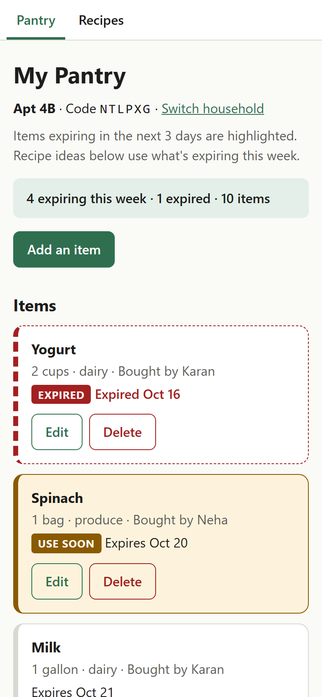

# Grocery Mate

One shared pantry for the whole apartment.

## Authors

- Aaryan Kathole ([github.com/Aaryan0111](https://github.com/Aaryan0111))
- Aryan Sarode ([github.com/AryanSarode14](https://github.com/AryanSarode14))

## Class

CS 5610 Web Development, Northeastern University: <PASTE CLASS LINK>

## Live Site

https://grocery-mate-0c8p.onrender.com

## Objective

Grocery Mate lets roommates share one pantry by joining the same household with a short code. Everyone sees what's expiring soon, gets recipe ideas that use those items from a 5,000-recipe Food.com catalog, and can add their own household recipes alongside the catalog.

## Screenshot



## Features

### Aaryan Kathole

- **Households:** create a household and get a 6-character join code, or join an existing one with its code. The code is saved in the browser and sent with every request.
- **Pantry CRUD with validation:** add, edit and delete items (name, quantity, category, bought by, expiry date). The server checks every field and rejects impossible dates.
- **Expiry sorting and highlighting:** items are sorted by soonest expiry, with no-expiry items last. Expired items are flagged and items expiring soon get a "Use soon" badge.
- **Expiring-this-week summary:** an aggregation that counts total, expired, expiring soon, expiring this week, and no-expiry items.
- **Recipe suggestions:** an aggregation that ranks catalog recipes by how many of this week's expiring items they use, then by how many of their ingredients the household already has.
- **Pages:** Join Household (`index.html`), My Pantry (`pantry.html`), Add/Edit Item (`pantry-form.html`).

### Aryan Sarode

- **Household recipe CRUD:** add, edit and delete recipes with name, minutes, ingredients, steps, tags, description and author, all validated on the server.
- **Search:** one search across the catalog and the household's own recipes, matching recipe names and ingredients. You can filter by tag and maximum cooking time, and results come 20 per page.
- **Recipes per tag:** an aggregation that counts recipes for the top 30 tags (generic Food.com tags hidden), shown as clickable filter chips.
- **Pages:** Browse Recipes (`browse.html`), Recipe Detail (`recipe.html`), Add/Edit Recipe (`recipe-form.html`).

## Tech Stack

- Node.js + Express (ES modules)
- MongoDB Atlas with the official MongoDB Node.js driver
- Vanilla JavaScript with `fetch` and client-side rendering
- ESLint and Prettier
- Deployed on Render

## Running Locally

### Prerequisites

- Node.js 22.x
- A MongoDB Atlas cluster (or any MongoDB connection string)

### Steps

1. Clone the repo and install dependencies:

   ```bash
   git clone https://github.com/AryanSarode14/grocery-mate.git
   cd grocery-mate
   npm install
   ```

2. Copy `.env.example` to `.env` and set:
   - `MONGO_URI`: your MongoDB connection string, including your database username, password and cluster host. The app uses the `groceryMate` database.
   - `PORT` (optional): defaults to 3000.

3. Load the recipe catalog:
   - Download `RAW_recipes.csv` from the [Food.com Recipes and User Interactions](https://www.kaggle.com/datasets/shuyangli94/food-com-recipes-and-user-interactions) dataset on Kaggle.
   - Put it at `data/RAW_recipes.csv` (the `data/` folder is gitignored).
   - Run:

     ```bash
     node scripts/importCatalog.js
     ```

     or `npm run import`. This replaces the `catalog` collection with the first 5,000 valid recipes.

4. Start the dev server and open http://localhost:3000:

   ```bash
   npm run dev
   ```

Other scripts: `npm run lint` runs ESLint, and `npm run format` runs Prettier on the whole project.

## API Routes

"Header" means the `x-household-code` header. Required routes return 401 without it and 404 if the code doesn't exist.

| Method | Path                         | Header   | What it does                                                                                       |
| ------ | ---------------------------- | -------- | -------------------------------------------------------------------------------------------------- |
| GET    | `/api/health`                | No       | Checks the database connection                                                                     |
| POST   | `/api/households`            | No       | Creates a household and returns its name and code                                                  |
| GET    | `/api/households/me`         | Required | Returns the current household's name and code                                                      |
| GET    | `/api/pantry`                | Required | Lists pantry items sorted by expiry                                                                |
| GET    | `/api/pantry/summary`        | Required | Expiry summary counts (optional `?today=YYYY-MM-DD`)                                               |
| GET    | `/api/pantry/suggestions`    | Required | Up to 12 catalog recipes using items expiring this week                                            |
| GET    | `/api/pantry/:id`            | Required | Gets one pantry item                                                                               |
| POST   | `/api/pantry`                | Required | Adds a pantry item                                                                                 |
| PUT    | `/api/pantry/:id`            | Required | Updates some or all fields of a pantry item                                                        |
| DELETE | `/api/pantry/:id`            | Required | Deletes a pantry item                                                                              |
| GET    | `/api/recipes`               | Optional | Searches recipes (`q`, `tag`, `maxMinutes`, `page`); with the header it includes household recipes |
| GET    | `/api/recipes/tags`          | Optional | Top 30 tags with recipe counts                                                                     |
| GET    | `/api/recipes/catalog/:id`   | No       | Gets one catalog recipe                                                                            |
| GET    | `/api/recipes/household/:id` | Required | Gets one household recipe                                                                          |
| GET    | `/api/household-recipes`     | Required | Lists the household's recipes, newest first                                                        |
| GET    | `/api/household-recipes/:id` | Required | Gets one household recipe                                                                          |
| POST   | `/api/household-recipes`     | Required | Adds a household recipe                                                                            |
| PUT    | `/api/household-recipes/:id` | Required | Updates some or all fields of a household recipe                                                   |
| DELETE | `/api/household-recipes/:id` | Required | Deletes a household recipe                                                                         |

## Data Model

- **households:** `name`, `code` (unique, 6 characters), `createdAt`
- **pantryItems:** `householdCode`, `name`, `quantity`, `category`, `boughtBy`, `expiry` (date or null), `createdAt`
- **catalog:** `_id` (Food.com recipe id), `name`, `minutes`, `tags`, `ingredients`, `steps`, `description`, `nIngredients` (read-only; written only by the import script)
- **householdRecipes:** `householdCode`, `name`, `minutes`, `tags`, `ingredients`, `steps`, `description`, `createdBy`, `nIngredients`, `createdAt`

## Project Structure

```
grocery-mate/
├── server.js             Express app and route mounting
├── db/                   MongoDB connection and queries per collection
├── routes/               Express routers (households, pantry, recipes, household recipes)
├── middleware/           householdCode.js checks the x-household-code header
├── scripts/              importCatalog.js loads the Food.com catalog
├── frontend/             Static HTML pages
│   ├── css/              base.css plus one stylesheet per page
│   └── js/               api.js fetch helper plus one script per page
├── docs/                 README screenshot
└── .env.example          Environment variable template
```

## Use of Generative AI


## License

[MIT](LICENSE)
